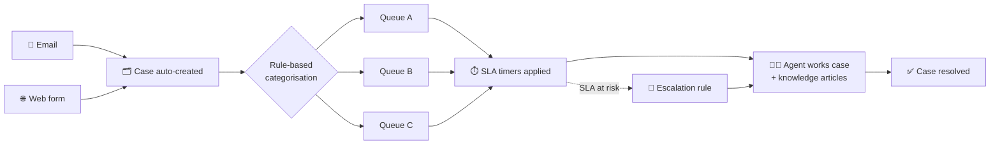

# 🎧 Customer Service Case Automation — Case Study

> Automated case creation, categorisation, routing, SLAs and escalations in Dynamics 365 Customer Service, aimed at reducing manual triage and average handling time (AHT).

---

## 🧩 Business problem

Customer requests arriving by **email and web forms** had to be triaged by hand: someone had to create the case, decide what it was about and send it to the right team. Manual triage slows down first response and pushes up **average handling time (AHT)**.

## 💡 Solution overview

Use **Dynamics 365 Customer Service** with **Power Automate** to:

- **Automatically create cases** from email and web forms
- **Categorise cases with rules** and **route them to queues**
- Apply **SLAs** and **escalation rules** so nothing is missed
- Support agents with **knowledge articles**

## 🏗️ Workflow / architecture

## ✨ Key features

- Automatic case creation from **email** and **web forms**
- **Rule-based categorisation** and **routing to queues**
- **SLAs** to track response and resolution commitments
- **Escalation rules** for cases at risk
- **Knowledge articles** to help agents resolve cases consistently

## 👩‍💼 My role

- Designed the case automation approach in Dynamics 365 Customer Service and Power Automate

## 📈 Outcomes

- Designed to **reduce manual triage** and **average handling time (AHT)**.

## 🖼️ Screenshots

> _Screenshots coming soon._

| Case form | Routing rules | SLA / escalation |
|---|---|---|
| _placeholder_ | _placeholder_ | _placeholder_ |

## 🧠 Key learnings

- Good categorisation rules are the foundation — routing, SLAs and reporting all depend on them.
- SLAs and escalations work best when they match how each team actually works.
- Knowledge articles help agents resolve cases consistently.

---

Built by [Mubeena M E](https://github.com/mubeename) · [LinkedIn](https://www.linkedin.com/in/mubeename)
